# Nirogi — Project Report

**SE4041 Mobile Application Design and Development · Assignment 02, Part A**
**Harindu Weligepola · IT23257504 · BSc (Hons) in Information Technology, Year 4**
**SLIIT Faculty of Computing**

---

## Contents

1. [Purpose and target audience](#1-purpose-and-target-audience)
2. [Design decisions](#2-design-decisions)
3. [Development challenges](#3-development-challenges)
4. [Testing and results](#4-testing-and-results)
5. [Performance optimisation](#5-performance-optimisation)
6. [Evaluation against the brief](#6-evaluation-against-the-brief)
7. [Reflections](#7-reflections)
8. [Future work](#8-future-work)

---

## 1. Purpose and target audience

### The problem

Reading a food label is a genuinely difficult task for someone with a food
allergy, and the difficulty is not simply that the print is small. Allergens
hide behind technical names that never mention the allergen itself. A person who
knows they must avoid dairy is unlikely to know that **casein**, **caseinate**,
**whey**, **lactalbumin** and **ghee** all mean dairy. A parent checking a
biscuit packet for a child with a peanut allergy may not recognise **arachis
oil** or **groundnut**.

In Sri Lanka the problem has a local dimension that international apps do not
address at all. **Umbalakada** — dried Maldive fish — appears in a great many
savoury products, from sambols to instant noodle sachets. No foreign allergen
database lists it, because outside the region it does not exist as an
ingredient. The same is true of **thala** (sesame), **kaju** (cashew) and
**pol kiri** (coconut milk).

### Target audience

| Audience | Why Nirogi suits them |
|---|---|
| **People with food allergies** in Sri Lanka | Recognises both international hidden names and local ingredients that foreign apps miss |
| **Parents of allergic children** | A clear, explained verdict is faster and less error-prone than reading a panel in a shop aisle |
| **People managing diabetes or blood pressure** | Personal nutrient limits flag products that exceed them |
| **Vegetarian, vegan and halal consumers** | Dietary conflicts are detected and reported as Caution rather than danger |

The design follows from the audience. The verdict is a single large word in a
distinct shape, readable at arm's length in a shop. The reasoning is always
present but secondary. The disclaimer is prominent, because the audience
includes people for whom a mistake is dangerous.

### Why this is not just another allergen app

The defining idea is that **the verdict is personal**. The same photograph of
the same packet produces:

| User | Profile | Verdict |
|---|---|---|
| A | Severe peanut allergy | 🔴 Avoid — *may contain traces of peanuts* |
| B | Gluten intolerant, vegan | 🔴 Avoid — *wheat flour; whey powder is not vegan* |
| C | Shellfish allergy | 🟢 Safe |

Demonstrating this — changing a profile and watching the same label be re-judged
— is the clearest single proof of what the app does.

---

## 2. Design decisions

### 2.1 Why Vision rather than ARKit or Core ML

Vision text recognition was chosen over the alternatives for reasons of fit
rather than novelty:

- **The feature is the app.** Without OCR, Nirogi cannot exist. This is the
  opposite of bolting an emerging technology onto an app that does not need it.
- **It works without a camera.** Vision runs on any `CGImage`, so the app can
  be demonstrated in the Simulator using bundled label images that go through
  exactly the same pipeline.
- **Privacy.** On-device recognition means an allergy profile and photographs of
  what someone eats never leave the phone. For medical-adjacent data this is the
  right default, not a feature.
- **No model training needed.** A custom Core ML classifier would have added
  training effort without serving the actual problem, which is reading text.

### 2.2 A pure, dependency-free engine

The single most consequential architectural decision was keeping `SafetyEngine`
free of SwiftUI, SwiftData and Vision. It takes value types in and returns value
types out.

The payoff appeared repeatedly during development. It made 67 unit tests
possible without a simulator; it let parsing and matching move to a background
task with no locking; and it meant the same code judges a new scan and re-judges
a saved one. To preserve the boundary, `UserProfile` exposes an immutable
`ProfileSnapshot` and the engine never sees the SwiftData model.

### 2.3 Never show a verdict without a reason

An early version showed only the verdict. It was unconvincing in a way that is
worth articulating: a red cross with no explanation looks like magic, and magic
is not trustworthy when the stakes are a medical reaction.

Every finding therefore carries its own evidence — the exact words found, the
rule they triggered, the connection between them, and the confidence of the
match. The result screen also exposes the **raw OCR text**, so a user can check
the app's reading against the packet in their hand. That panel later turned out
to be the single most valuable debugging tool in the project (see §3.2).

### 2.4 Failing towards caution

Several small decisions share one principle: when uncertain, err towards
warning the user rather than reassuring them.

- An unrecognised stored verdict decodes as **Caution**, not Safe
- Allergens selected during onboarding default to **Moderate**, which produces
  Avoid — the user can relax a rule, which is safer than having to tighten one
- A low-confidence scan produces a visible warning rather than a silent verdict
- A fuzzy match is labelled *"possible scan error — please double-check"*

### 2.5 Accessibility as a design constraint

Red and green are the worst possible pair for the roughly 8% of men with colour
vision deficiency — which is a real portion of the target audience, not a
hypothetical one. Every verdict therefore carries **three** independent signals:
colour, a distinct symbol outline (seal, triangle, octagon) and an explicit
word. The verdict remains readable in greyscale.

Contrast was measured rather than assumed. The first palette draft failed: jade
at `#0F8A6A` gave only 4.04:1 against the light background, below the 4.5:1 AA
threshold for body text. Separate darker `…Text` tokens were introduced, lifting
it to 6.61:1.

### 2.6 Visual identity

"Jade and turmeric" — jade green for health and trust, turmeric gold as a warm
Sri Lankan accent. The name **Nirogi** (නිරෝගී, "healthy") states the benefit
rather than the mechanism and is understood across Sinhala, Tamil and English
speakers. The icon is a jade leaf with a checkmark in its negative space, set
inside scan-frame brackets: the two ideas of the app in one mark.

iOS 26's **Liquid Glass** was adopted fully rather than imitated. The background
gradient exists specifically so the glass has something to refract; on a flat
background it looks grey and dead.

---

## 3. Development challenges

The three most instructive problems all shared a theme: **Vision reports what it
sees, not what a human would understand.**

### 3.1 "Coconut milk" is not dairy

The first version flagged coconut milk as dairy, because the dairy synonym list
contains `milk` and `coconut milk` contains the word `milk`. In Sri Lanka, where
coconut milk is in almost everything, this single false positive would have made
the app useless.

Two mechanisms fixed it:

1. **Exclusion phrases** per allergen — `coconut milk`, `soya milk`,
   `cocoa butter` and so on veto a match.
2. **Longest-match resolution** — a candidate sitting inside a longer match from
   a different allergen is discarded, so `milk` (8–12) loses to
   `coconut milk` (0–12).

A unit test then found a third case the first two missed. In
`coconut milk powder`, the dairy synonym **`milk powder`** spans characters
8–19 — it *overlaps* the excluded phrase `coconut milk` (0–12) without being
contained by it, so a containment check let it through. Changing the test from
containment to **overlap** fixed it.

> **What I learned.** Negative cases deserve as much test coverage as positive
> ones. Every false positive I found came from a word appearing inside a longer
> phrase that meant something different.

### 3.2 The column-major nutrition table

The app reported **620 g of sugar** for a coconut milk powder — a number that is
not merely wrong but impossible, since 620 g cannot fit in 100 g of product.

Opening the app's own *"What the scan saw"* panel revealed the cause
immediately. Because the printed table has a wide gap between its two columns,
Vision had returned the text **column by column**:

```
Energy          ← all three names first
Sugar
Salt
620 kcal        ← then all three values
8.0 g
180 mg
```

My parser took the first number after each keyword, so `Sugar` was paired with
the energy figure. For a diabetic user a confidently wrong number is worse than
no number at all.

The fix needed four changes: preserve line structure for nutrition parsing;
scope the search to the nutrition table so additive codes like `E322` cannot be
read as values; cut each search window at the next nutrient's name; and pair
column layouts positionally, but only when the layout genuinely is one block of
names followed by one block of values, with every pairing unit-checked.

> **What I learned.** The debugging feature I built for the *user* was what
> found the bug. Exposing the system's intermediate state is not just good UX —
> it is good engineering.

### 3.3 The vanishing peanut warning

Scanning a biscuit label, the app reported dairy but silently missed *"May
contain traces of peanuts"* — despite the profile having a peanut allergy.

The label printed the warning under its own `ALLERGEN ADVICE:` heading. My
parser treated that heading as the end of the ingredient list and trimmed
everything after it — including the warning — *before* looking for trace
wording. My hand-written test strings had no such heading, so the bug was
invisible until a real label was scanned.

Reordering the operations fixed it: locate the trace warning first, then trim
each part at its own terminator.

> **What I learned.** Test fixtures I invent reflect what I already expect.
> Testing against real artefacts finds the cases I did not think of.

### 3.4 Transpositions and OCR noise

`casien` for `casein` is the most common kind of OCR error, and plain
Levenshtein distance scores a transposition as **2**, so a distance-1 check
misses it entirely. The matcher uses a bounded **Damerau-Levenshtein** check
instead, which treats an adjacent swap as one edit. It is deliberately limited
to words of five characters or more, because one character of slack on `egg` or
`soy` would match far too much.

### 3.5 The background work that was not in the background

A compiler warning late in the project revealed that a claim I had already
written into the documentation was false.

The project is configured with `SWIFT_DEFAULT_ACTOR_ISOLATION = MainActor`,
which is the modern Xcode default. That setting makes *every* type in the
module implicitly main-actor isolated — including `LabelParser` and
`SafetyEngine`, the types I had carefully designed to be pure and
framework-free.

So this code:

```swift
let analysis = await Task.detached(priority: .userInitiated) {
    let parsed = LabelParser.parse(output.text)
    return engine.analyse(label: parsed, profile: profile)
}.value
```

was not running the work off the main actor at all. The detached task
immediately hopped *back* to the main actor to call two main-isolated methods.
The interface was never actually freed up, and the app only felt responsive
because the work is fast.

The fix was to mark the pure types `nonisolated`, which is what I had assumed
they were all along:

```swift
nonisolated enum LabelParser { … }
nonisolated struct SafetyEngine: Sendable { … }
```

> **What I learned.** Architecture is not what you intend, it is what the
> compiler actually enforces. I had written "runs off the main actor" in a
> source comment *and* in the technical documentation before checking whether
> it was true. The warning was easy to overlook among build output, and had I
> not read the warnings the documentation would have shipped with a confident,
> incorrect claim.

### 3.6 Localization that silently did nothing

After adding Sinhala and Tamil, parts of the interface stayed stubbornly
English — with no warning or error. The cause is a genuine SwiftUI subtlety:
**only string literals passed directly into `Text` are auto-localized.** A
`String` variable is rendered verbatim.

Because `GlassCard.title`, `EmptyState.message` and several helpers took
`String`, every literal passed through them bypassed the string catalogue.
Changing those parameters to `LocalizedStringKey`, and routing model-supplied
strings through `String(localized:)`, fixed it. Verification was done by
actually launching under `-AppleLanguages (si)` and `(ta)` and reading the
screen, rather than trusting that the catalogue existed.

---

## 4. Testing and results

### 4.1 Strategy

Testing was layered, with the heaviest coverage where logic is densest and
consequences are highest.

| Layer | Tests | What it proves |
|---|---|---|
| Unit — engine | 30 | The matching rules are correct |
| Unit — parser | 22 | Messy OCR becomes correct structured data |
| Unit — models | 15 | Persistence and knowledge-base integrity |
| UI — end to end | 9 | The real app works with real Vision OCR |
| **Total** | **76** | **All passing** |

During development a standalone command-line harness compiled the pure logic
files and ran them directly, giving a sub-second feedback loop long before the
interface existed. That harness caught the first four bugs in this report.

### 4.2 What the tests found

Every bug in §3 was caught by a test or by the app's own diagnostics, and each
is now covered by a regression test.

| Bug | Found by | Regression test |
|---|---|---|
| Coconut milk read as dairy | Logic harness | `testCoconutMilkIsNotDairy` |
| `milk powder` overlapping an exclusion | Unit test | `testLongestMatchWins` |
| Salt read as `322` from `E322` | Logic harness | `testAdditiveNumbersAreNotReadAsNutrients` |
| Column-major table misread | Scanning a real sample | `testColumnMajorNutritionTable` |
| Trace warning lost under a heading | Scanning a real sample | `testTraceWarningSurvivesAllergenAdviceHeading` |
| Transposition not matched | Logic harness | `testTransposedLettersAreCaught` |
| Profile toggle not findable | UI test | `testProfileChangesArePersisted` |
| Verdict badge broke mid-word at accessibility text sizes | Manual UAT | Visual check, §4.4 |
| Background work silently running on the main actor | Compiler warning | Warning-free build |

Two bugs were found by **running the app**, not by testing it. Both involved
real Vision output differing from what I had imagined OCR would produce. This is
the strongest argument in the project for testing against real artefacts.

### 4.3 User acceptance testing

The journeys below were walked through on an iPhone 17 Pro simulator running
iOS 26.1, against the acceptance criteria implied by the brief.

| # | Scenario | Expected | Result |
|---|---|---|---|
| 1 | First launch | Disclaimer must be accepted before use | ✅ Pass |
| 2 | Select allergens in onboarding | Persisted and shown on Home | ✅ Pass |
| 3 | Scan a label with hidden dairy | Avoid, naming *whey powder* | ✅ Pass |
| 4 | Same label, peanut-only profile | Avoid, citing the trace warning only | ✅ Pass |
| 5 | Same label, unrelated profile | Safe | ✅ Pass |
| 6 | Scan a clean label | Safe, nothing flagged | ✅ Pass |
| 7 | Scan coconut milk powder with a dairy allergy | Flags caseinate, **not** coconut milk | ✅ Pass |
| 8 | Scan a label with umbalakada | Flags Maldive fish | ✅ Pass |
| 9 | Save a scan, force-quit, relaunch | History intact | ✅ Pass |
| 10 | Edit profile, reopen a saved scan | Re-judged, change announced | ✅ Pass |
| 11 | Switch to Dark Mode | All screens legible | ✅ Pass |
| 12 | Increase Dynamic Type to an accessibility size | Text scales, chips reflow, nothing clipped | ⚠️ Failed first, then passed — see below |
| 13 | Run on iPad Pro 11-inch | Layout adapts to the larger screen | ✅ Pass |
| 14 | Switch language to Sinhala | Interface in Sinhala | ✅ Pass |
| 15 | Switch language to Tamil | Interface in Tamil | ✅ Pass |
| 16 | Scan an unreadable image | Clear error, option to retry | ✅ Pass |

#### Scenario 12 — the one that failed

Raising Dynamic Type to an accessibility size exposed a real layout defect that
no automated test would have caught. The verdict badge in a history row broke
mid-word and overflowed its capsule:

> **Avo**
> **id**

Two fixes were applied. The badge's text now has `lineLimit(1)`, `fixedSize()`
and a deliberate `dynamicTypeSize` ceiling — body text must scale all the way up
for readability, but a fixed-width ornament that grows without limit becomes
*less* legible, not more. Separately, `HistoryRow` now switches to a vertical
layout when `dynamicTypeSize.isAccessibilitySize` is true, instead of squeezing
a long product name and a badge onto one line.

This is worth recording because it is the kind of defect that only appears when
someone actually turns the setting on and looks at the screen. The unit tests
could not see it, and the UI tests passed throughout.

### 4.5 Device and appearance coverage

| Configuration | Verified |
|---|---|
| iPhone 17 Pro, iOS 26.1 | ✅ Primary development target |
| iPad Pro 11-inch (M5), iOS 26.1 | ✅ Layout adapts; tab bar moves to the top |
| Light appearance | ✅ |
| Dark appearance | ✅ |
| Accessibility text sizes | ✅ After the fix above |
| English / Sinhala / Tamil | ✅ Each launched and read on screen |

### 4.6 Known-good evidence

Verified behaviour on the bundled samples, with a profile of severe dairy and
moderate peanut:

| Sample | Verdict | Evidence cited |
|---|---|---|
| Cream Biscuits | 🔴 Avoid | *whey powder* → Dairy (contains); *peanuts* → Peanut (may contain) |
| Coconut Milk Powder | 🔴 Avoid | *sodium caseinate* → Dairy. Coconut milk correctly ignored |
| Plain Rice Crackers | 🟢 Safe | Nothing matched |

Nutrition values were read correctly in both layouts, including the unit
conversion from `1.2 g` of salt to `1200 mg`.

---

## 5. Performance optimisation

| Area | Optimisation | Rationale |
|---|---|---|
| **Launch** | Knowledge base parsed once in the composition root | Avoids re-parsing 303 terms per scan or per render |
| **Lookup** | Dictionary index by allergen ID | Avoids a linear scan |
| **Matching** | Search terms pre-sorted longest-first | Ordering computed once, not per match |
| **Matching** | Fuzzy pass only when nothing matched exactly | The expensive path is the rare path |
| **Matching** | Bounded edit distance with early exit | Never computes a full distance matrix |
| **Responsiveness** | Parsing and matching on a detached task | Interface stays live during a scan |
| **Concurrency** | Text and barcode recognition run together | Two independent passes over one image |
| **Memory** | Images JPEG-compressed at 0.6 and externally stored | A raw capture is several MB; history would grow unmanageably |
| **Queries** | `@Attribute(.externalStorage)` on image data | Keeps the database small and fetches fast |

Baselines are captured by `XCTest`'s `measure` for label parsing, analysis and
application launch, so regressions would be visible.

---

## 6. Evaluation against the brief

| Requirement | How it is met |
|---|---|
| **Purpose and audience** | §1 — a real problem with a locally specific dimension |
| **Advanced UI elements** | Liquid Glass, custom animations, spring entrance, gesture-driven navigation, adaptive layouts |
| **SwiftUI components and customisation** | `GlassCard` component, `.nirogiCard()` modifier, custom `FlowLayout` |
| **Navigation and architecture** | `TabView` + `NavigationStack`, MVVM, six screens |
| **Data persistence** | SwiftData for profile and history, with external image storage |
| **Emerging technology** | **Vision** (OCR + barcode) as the app's core, plus MapKit and Localization |
| **Visual design and branding** | Custom icon with light/dark/tinted variants, jade-and-turmeric palette, consistent tokens |
| **Accessibility** | Dark Mode, Dynamic Type, VoiceOver, Reduce Motion, verified contrast, colour independence |
| **Testing** | 76 tests, unit + UI + UAT, with performance baselines |
| **Documentation** | README, user guide, technical documentation, this report, AI usage log |
| **Version control** | Git with feature branches and descriptive commits |

---

## 7. Reflections

### What went well

**Choosing a problem where the technology is the point.** Because Vision is what
makes Nirogi possible, the integration never felt decorative. Design decisions
followed naturally from the problem rather than from a wish to use a framework.

**The pure engine.** Keeping the matching logic free of frameworks paid off more
than any other decision. It is why there are 67 fast unit tests rather than a
handful of slow ones, and why every bug in §3 could be pinned down by a failing
test in seconds.

**Building the user-facing diagnostic.** The "What the scan saw" panel was added
for users who get a surprising result. It then found the hardest bug in the
project. Features that expose a system's intermediate state help the person
building it as much as the person using it.

### What I would do differently

**Test against real data sooner.** Two of the five significant bugs were
invisible to my hand-written test strings, because those strings encoded what I
*assumed* OCR output looks like. The column-major table was something I would
never have invented. I should have run a real label through Vision on day one.

**Write the negative tests first.** My early tests all asked "does it find the
allergen?". The valuable ones turned out to ask "does it *avoid* finding one
that isn't there?". For a tool people rely on, a false positive erodes trust
until the app gets ignored — which is itself a safety failure.

**Verify localization by looking at it.** Adding a string catalogue created the
*appearance* of a translated app while half the interface silently stayed
English. Nothing warned me. The lesson generalises: a feature that fails
silently needs to be verified by observation, not by inspection of the code.

### On using AI assistance

AI assistance (Claude) was used throughout, and is logged in full in
[AI_USAGE_LOG.md](AI_USAGE_LOG.md). The honest assessment is that it was most
useful for breadth and speed — scaffolding, boilerplate, the synonym lists — and
that the parts of the project I value most came from the iteration *after* the
first draft: running real labels through the pipeline, reading the output,
noticing that 620 g of sugar is impossible, and reasoning about why.

The debugging in §3 is where the actual engineering happened. Each of those bugs
required understanding *why* Vision produced what it did, not just that the
output was wrong. That is the part I would be able to defend line by line, and
the part I learned the most from.

### What I learned

1. **OCR output is not the text you see.** It is a set of observations in an
   order determined by layout, not meaning.
2. **Matching text is mostly about not matching the wrong text.** Word
   boundaries, exclusions and longest-match resolution are the real work.
3. **Architecture is a testing decision.** Where I put the dependency boundary
   determined what I was able to test, which determined what I was able to fix.
4. **Accessibility is design, not decoration.** Choosing three distinct symbol
   shapes cost nothing and made the app work for people a colour-only design
   would exclude.
5. **Health-adjacent software needs a bias.** Deciding in advance to fail
   towards caution turned several small ambiguous choices into obvious ones.

---

## 8. Future work

| Idea | Value |
|---|---|
| **Product database behind barcodes** | Barcodes are already detected and stored; a lookup would let a known product be recognised instantly without re-reading the label |
| **Sinhala and Tamil OCR** | A Core ML model trained on local script would let the app read the whole label, not only the English portion |
| **Crowd-sourced synonyms** | Let users report a missed ingredient so the knowledge base improves |
| **Family profiles** | One phone, several people — a parent checking for two children with different allergies |
| **Shared safe lists** | Export a verified-safe product list to share within an allergy support community |
| **Apple Watch** | A glanceable verdict while standing in the aisle |

---

## Appendix: screenshots

| | | |
|---|---|---|
| 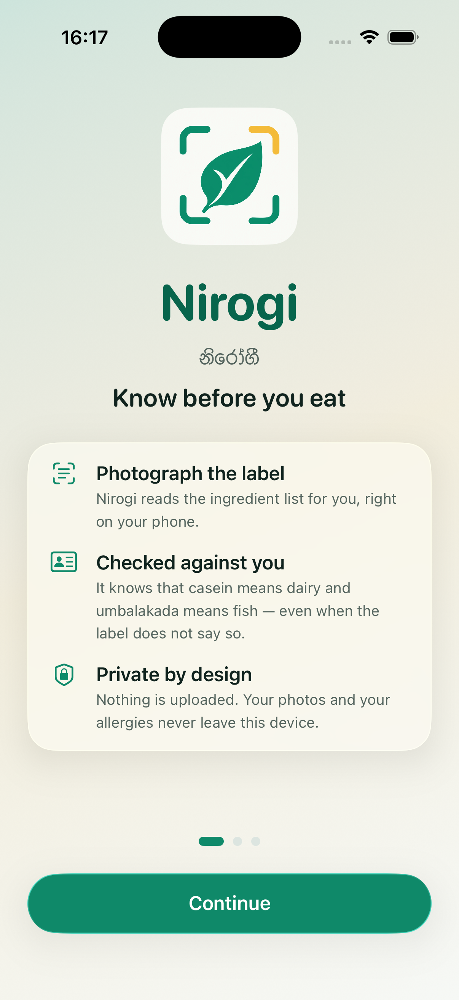 | 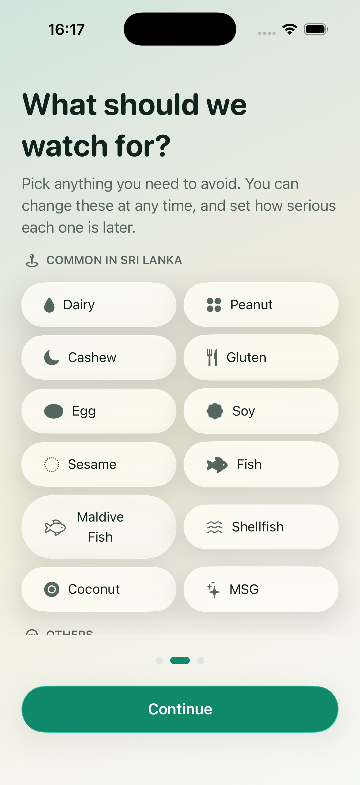 | 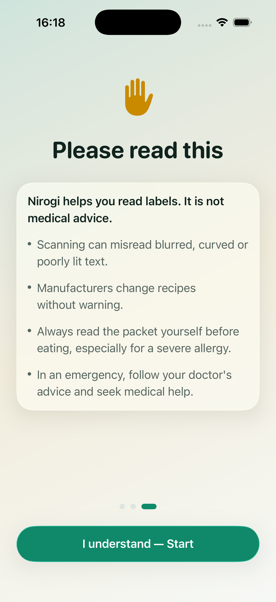 |
| Welcome | Choosing allergens | Safety disclaimer |
| 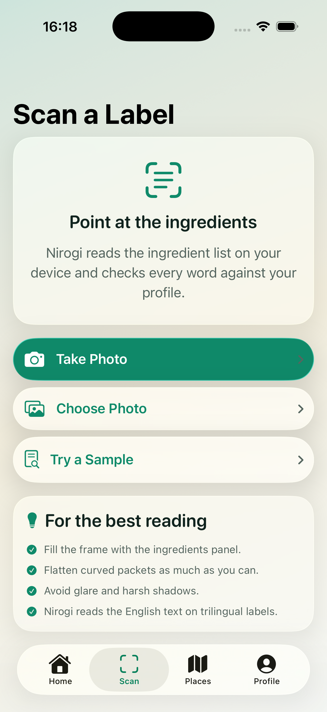 | 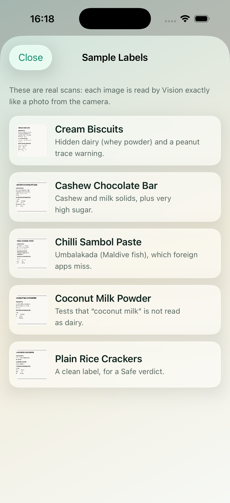 | 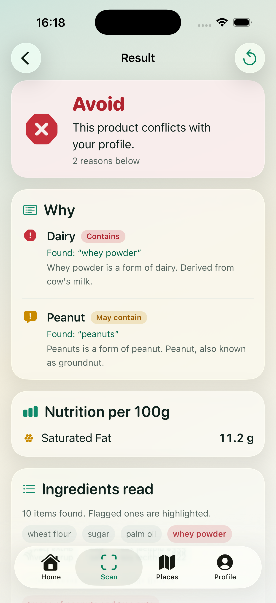 |
| Scan screen | Sample labels | An explained Avoid |
| 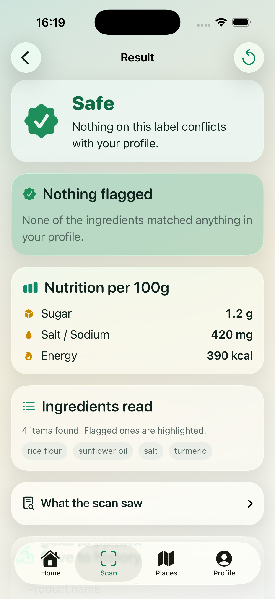 | 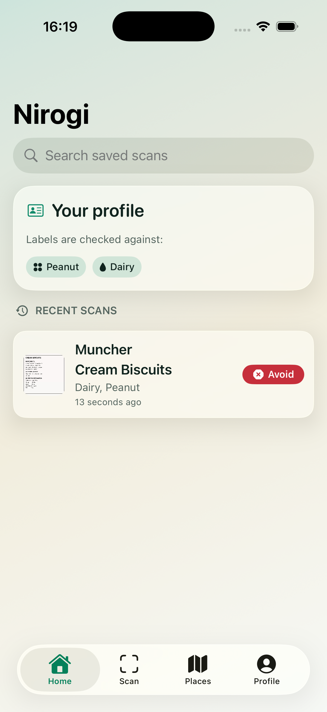 | 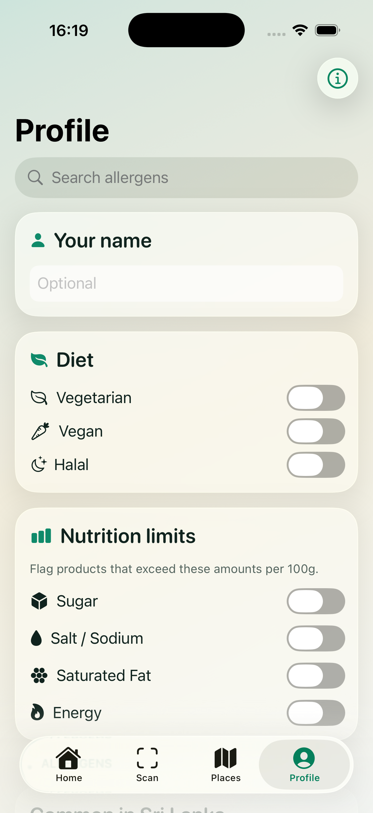 |
| A Safe verdict | Scan history | Allergen profile |
| 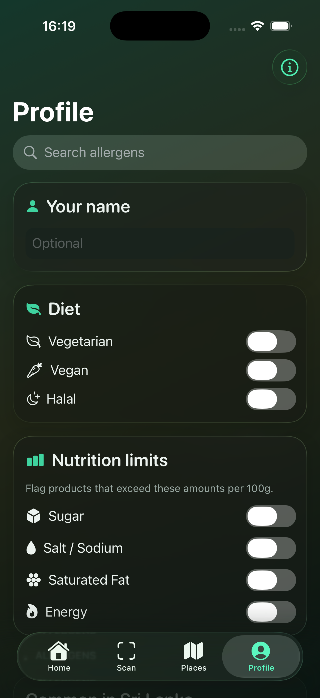 | 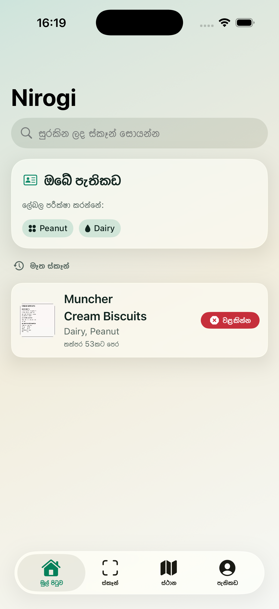 | 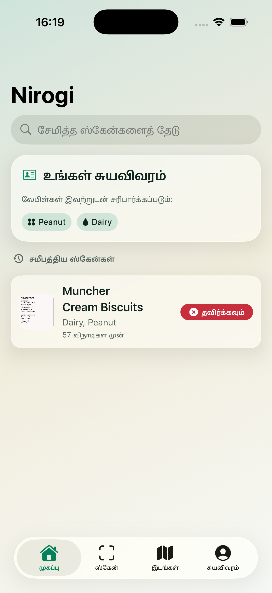 |
| Dark Mode | Sinhala interface | Tamil interface |
| 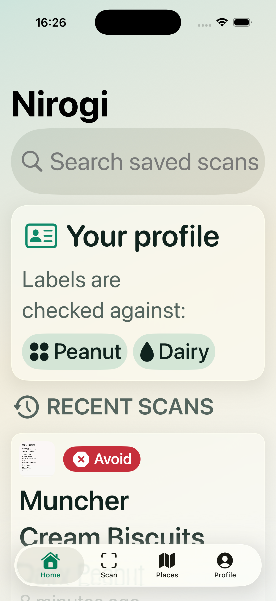 | 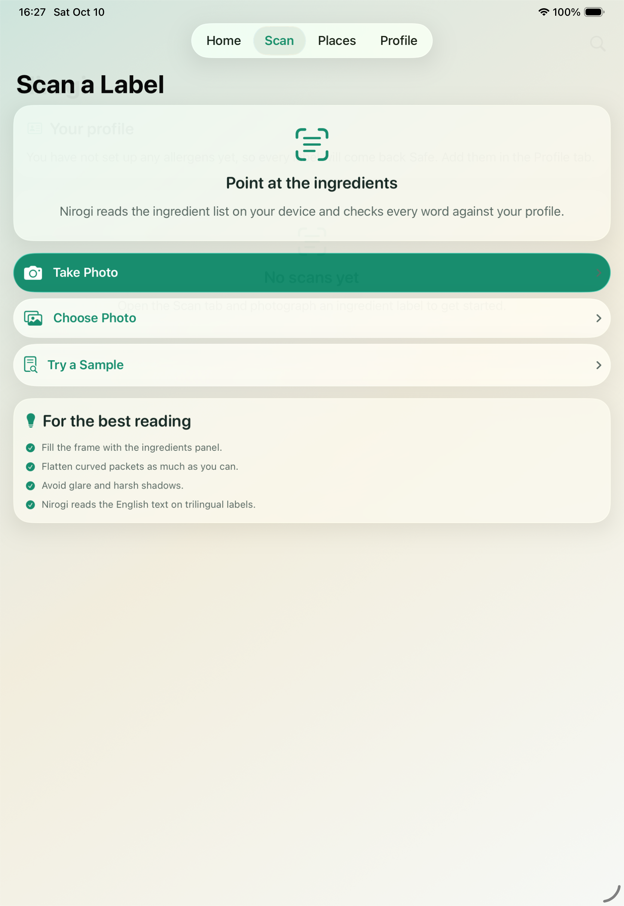 | |
| Accessibility text size | iPad layout | |
